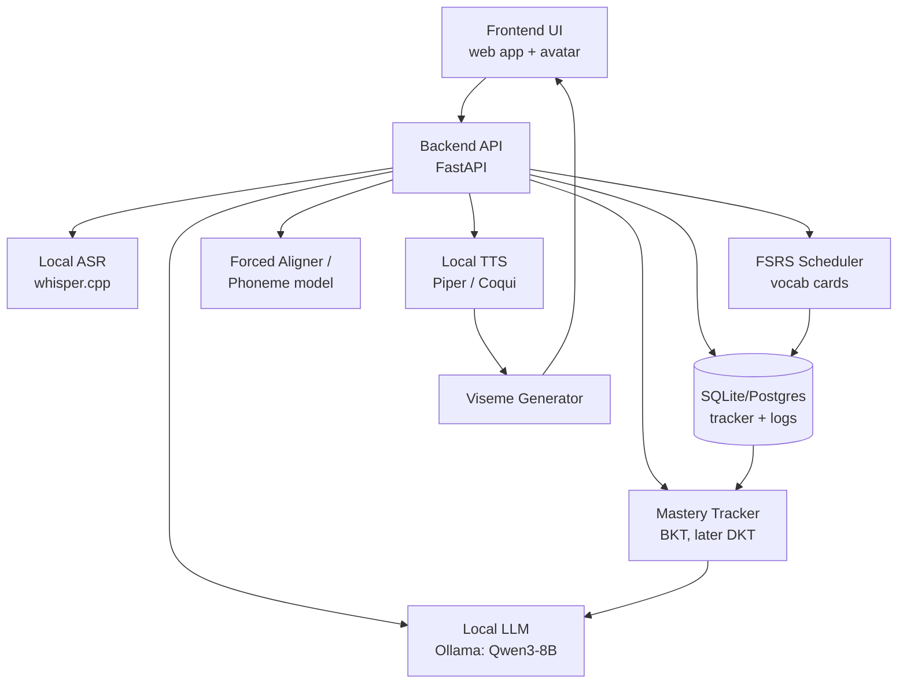
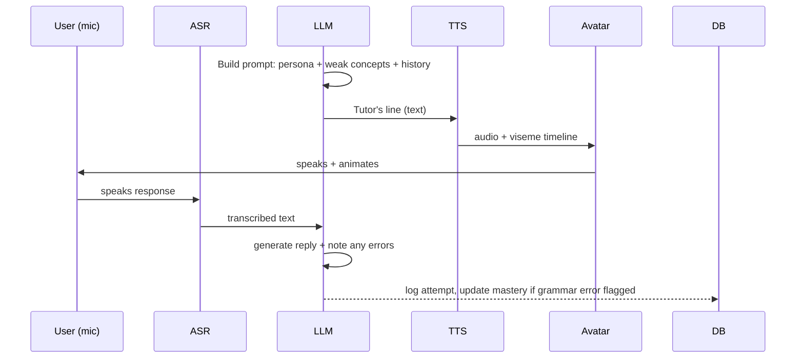
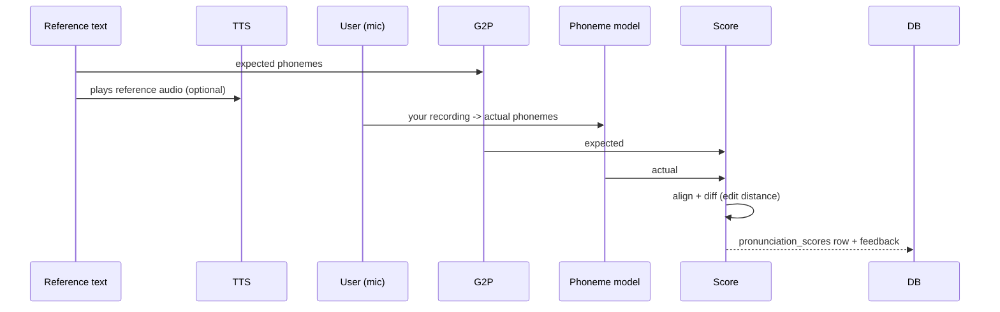

# Local French Tutor — Architecture Blueprint

A fully local, adaptive French-learning system: conversation practice, pronunciation correction, writing exercises, spaced-repetition vocab, weak-spot tracking, and an animated avatar — all running on your own machine.

---

## 1. System overview



**Core idea:** the LLM never needs fine-tuning to "remember" you. All adaptation lives in the database (mastery scores + FSRS schedule) and gets injected into the LLM's context each session. The LLM is stateless; your tracker is not.

---

## 2. Tech stack

| Layer | Choice | Why |
| --- | --- | --- |
| Backend | **Python + FastAPI** | Best ecosystem for ML glue (Whisper, TTS, phonemizer all Python-native) |
| DB | **SQLite** (→ Postgres if it grows) | Zero-ops, fine for single-user |
| LLM serving | **Ollama** (Qwen3:8b or 14b) | Local REST API, easy model swaps |
| ASR | **whisper.cpp** (French model) | Fast, local, word-level timestamps |
| TTS | **Piper** (fast, good French voices) or **Coqui TTS** (more expressive, slower) | Local, gives phoneme/timing data |
| G2P (text→phonemes) | **phonemizer** (espeak-ng backend, French) | Standard, free, good French coverage |
| Pronunciation scoring | **wav2vec2 French CTC model** (via Hugging Face `transformers`) or forced alignment with **Montreal Forced Aligner (MFA)** | Phoneme-level accuracy scoring |
| Scheduler | **FSRS** (py-fsrs package) | Modern spaced repetition, drop-in |
| Mastery tracking | Custom **BKT** (simple, ship first) → optional **DKT** (PyTorch, later) | Simple first, upgrade later |
| Frontend | **React** (or plain HTML/JS) + **PixiJS** or **Three.js** for avatar | Web stack, good animation libs |
| Avatar rig | **Live2D**-style 2D rig (PixiJS + `pixi-live2d-display`) *or* simple 3D rig (Three.js + morph targets) | No video generation — code-driven animation |
| Audio I/O | Browser `MediaRecorder` API → backend | Standard, no extra install |

Everything above runs fully offline once models are downloaded.

---

## 3. Database schema

```sql
-- Concepts you're tracking (grammar points, skills)
CREATE TABLE concepts (
    id INTEGER PRIMARY KEY,
    name TEXT NOT NULL,              -- "subjunctive_present", "liaison", "gender_agreement"
    category TEXT,                   -- "grammar", "pronunciation", "vocab"
    cefr_level TEXT                  -- "A1".."C2"
);

-- Every exercise the system ever generates/uses
CREATE TABLE exercises (
    id INTEGER PRIMARY KEY,
    type TEXT NOT NULL,              -- "conversation" | "read_aloud" | "writing" | "vocab" | "scenario"
    concept_id INTEGER REFERENCES concepts(id),
    content TEXT,                    -- prompt text / target sentence
    difficulty INTEGER,              -- 1-5
    created_at TIMESTAMP DEFAULT CURRENT_TIMESTAMP
);

-- One row per attempt at an exercise
CREATE TABLE attempts (
    id INTEGER PRIMARY KEY,
    exercise_id INTEGER REFERENCES exercises(id),
    session_id INTEGER REFERENCES sessions(id),
    user_input TEXT,                 -- transcribed speech or typed text
    correct BOOLEAN,
    score REAL,                      -- 0-1, graded score (pronunciation or grammar)
    feedback TEXT,                   -- LLM-generated explanation
    timestamp TIMESTAMP DEFAULT CURRENT_TIMESTAMP
);

-- Rolling mastery estimate per concept (BKT state)
CREATE TABLE mastery (
    concept_id INTEGER REFERENCES concepts(id) PRIMARY KEY,
    p_known REAL DEFAULT 0.3,        -- BKT: probability concept is "known"
    attempts_count INTEGER DEFAULT 0,
    last_attempt TIMESTAMP,
    streak INTEGER DEFAULT 0         -- consecutive correct, for gamification
);

-- Vocab/phrase cards under spaced repetition (FSRS fields)
CREATE TABLE vocab_cards (
    id INTEGER PRIMARY KEY,
    phrase_fr TEXT NOT NULL,
    translation TEXT,
    concept_id INTEGER REFERENCES concepts(id),
    stability REAL,                  -- FSRS memory stability
    difficulty REAL,                 -- FSRS difficulty
    due_date TIMESTAMP,
    reps INTEGER DEFAULT 0,
    lapses INTEGER DEFAULT 0
);

-- Pronunciation-specific detail (phoneme-level diff)
CREATE TABLE pronunciation_scores (
    id INTEGER PRIMARY KEY,
    attempt_id INTEGER REFERENCES attempts(id),
    expected_phonemes TEXT,          -- from G2P
    actual_phonemes TEXT,            -- from wav2vec2/ASR
    phoneme_errors TEXT,             -- JSON: [{expected, actual, position}]
    overall_score REAL
);

-- Session grouping (one practice sitting)
CREATE TABLE sessions (
    id INTEGER PRIMARY KEY,
    started_at TIMESTAMP DEFAULT CURRENT_TIMESTAMP,
    ended_at TIMESTAMP,
    mode TEXT,                       -- "conversation" | "drill" | "mixed"
    xp_earned INTEGER DEFAULT 0
);

-- Conversation turn log (for conversation/scenario mode)
CREATE TABLE conversation_turns (
    id INTEGER PRIMARY KEY,
    session_id INTEGER REFERENCES sessions(id),
    speaker TEXT,                    -- "user" | "tutor"
    text TEXT,
    audio_path TEXT,
    timestamp TIMESTAMP DEFAULT CURRENT_TIMESTAMP
);
```

**Key relationship:** `mastery.p_known` (low score) → feeds into the exercise generator's prompt → produces more `exercises` tagged to that `concept_id`.

---

## 4. BKT update rule (ship this before DKT)

Simple, well-understood, no training needed:

```python
def update_mastery(p_known: float, correct: bool,
                    p_learn=0.1, p_slip=0.1, p_guess=0.2) -> float:
    # Bayesian update given observation
    if correct:
        numer = p_known * (1 - p_slip)
        denom = numer + (1 - p_known) * p_guess
    else:
        numer = p_known * p_slip
        denom = numer + (1 - p_known) * (1 - p_guess)
    p_known_given_obs = numer / denom
    # apply learning transition
    return p_known_given_obs + (1 - p_known_given_obs) * p_learn
```

Run this after every `attempts` row; write the result back to `mastery.p_known`. Concepts below a threshold (e.g. `p_known < 0.6`) are "weak" — feed the lowest N into the next exercise generation prompt.

---

## 5. Exercise pipelines

### Conversation mode



### Read-aloud / pronunciation mode



### Writing mode

`exercise.content` (prompt) → user types → LLM grades against a rubric (grammar, concept-specific check) → writes `feedback`, updates `mastery` for any concept explicitly tested.

### Vocab review mode

Pull `vocab_cards` where `due_date <= now`, ordered by overdue-ness → quiz → FSRS update (`stability`, `difficulty`, next `due_date`) via `py-fsrs`.

---

## 6. Avatar / viseme pipeline

1. TTS (Piper) generates audio **and** phoneme-level timestamps.
2. Map French phonemes → a small viseme set (\~10-15 mouth shapes is enough; classic Preston Blair / Hanna-Barbera viseme sets work fine for French too).
3. Build a timeline: `[{start_ms, end_ms, viseme_id}, ...]`.
4. Frontend avatar (PixiJS + Live2D model, or Three.js + blend shapes) steps through the timeline in sync with audio playback.
5. Expression states (happy / encouraging / neutral / thinking) are just pre-made poses swapped based on session events (correct answer, hint given, streak milestone) — no generative video anywhere in the loop.

This only needs the TTS's phoneme timing, which you already have from the pronunciation pipeline — so build pronunciation scoring first and the avatar reuses that output.

---

## 7. Suggested repo structure

```
french-tutor/
├── backend/
│   ├── api/              # FastAPI routes
│   ├── tracker/          # BKT logic, mastery updates
│   ├── scheduler/        # FSRS wrapper
│   ├── llm/              # Ollama client, prompt templates
│   ├── speech/
│   │   ├── asr.py        # whisper.cpp wrapper
│   │   ├── tts.py        # Piper wrapper + phoneme extraction
│   │   ├── g2p.py        # phonemizer wrapper
│   │   └── score.py      # phoneme diff/scoring
│   ├── models/           # DB models (SQLAlchemy)
│   └── db.sql            # schema above
├── frontend/
│   ├── src/
│   │   ├── avatar/        # PixiJS/Three.js rig + viseme player
│   │   ├── modes/          # conversation / read-aloud / writing / vocab UI
│   │   └── api/
└── data/
    └── concepts_seed.json # initial concept list to seed `concepts` table
```

---

## 8. Build order (recap, now mapped to this schema)

1. **Schema + BKT tracker** — tables above, update rule, seed `concepts`.
2. **FSRS vocab loop** — `vocab_cards` + due-date quizzing.
3. **LLM conversation mode** — prompt template pulls low-`p_known` concepts from `mastery`.
4. **Writing mode** — reuse LLM + `attempts`/`feedback`.
5. **Pronunciation pipeline** — G2P + phoneme model + `pronunciation_scores`.
6. **Avatar + visemes** — built on top of #5's phoneme timing output.
7. **Gamification** — `sessions.xp_earned`, `mastery.streak`, simple levels.
8. **(Later) DKT** upgrade to tracker; **(later) LoRA** correction-style fine-tune.

---

## 9. Models to download, concretely

| Purpose | Model |
| --- | --- |
| Tutor LLM | `ollama pull qwen3:8b` |
| ASR | `whisper.cpp` French-capable model (e.g. `medium` or `large-v3`) |
| TTS | Piper French voice (`fr_FR-*`) |
| G2P | espeak-ng French backend via `phonemizer` |
| Phoneme scoring | a French wav2vec2-CTC model from Hugging Face (search `wav2vec2 french phoneme`) |
| Spaced repetition | `py-fsrs` (pip package) |
